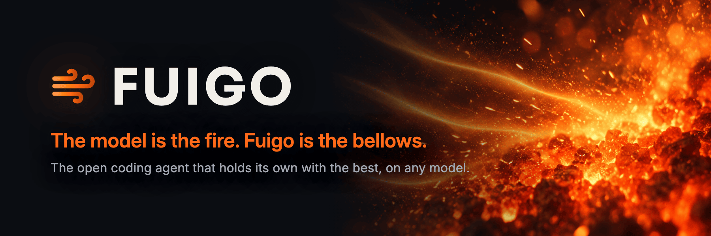
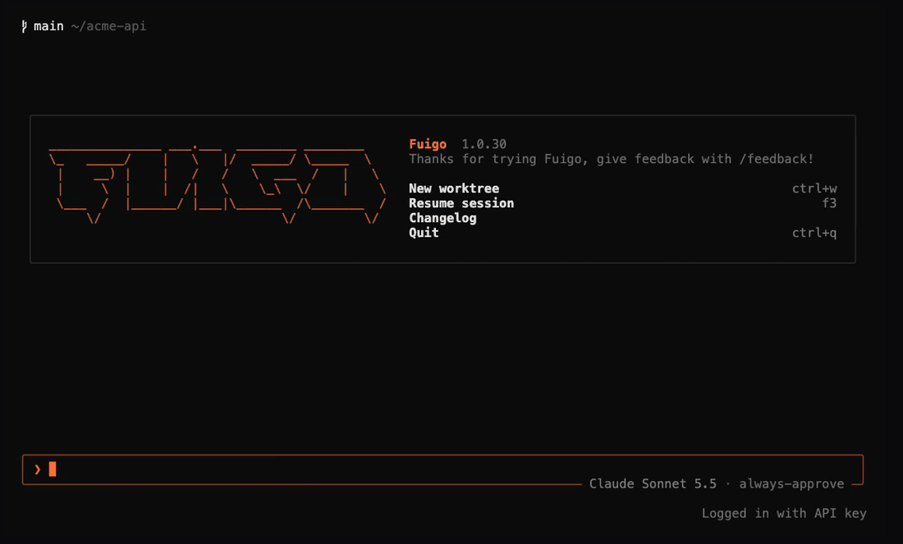
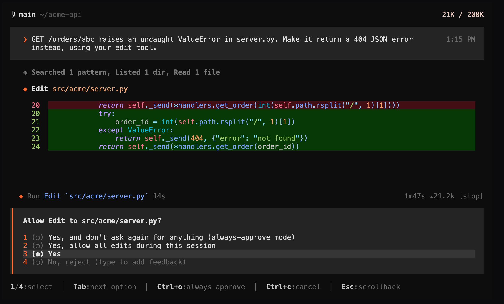
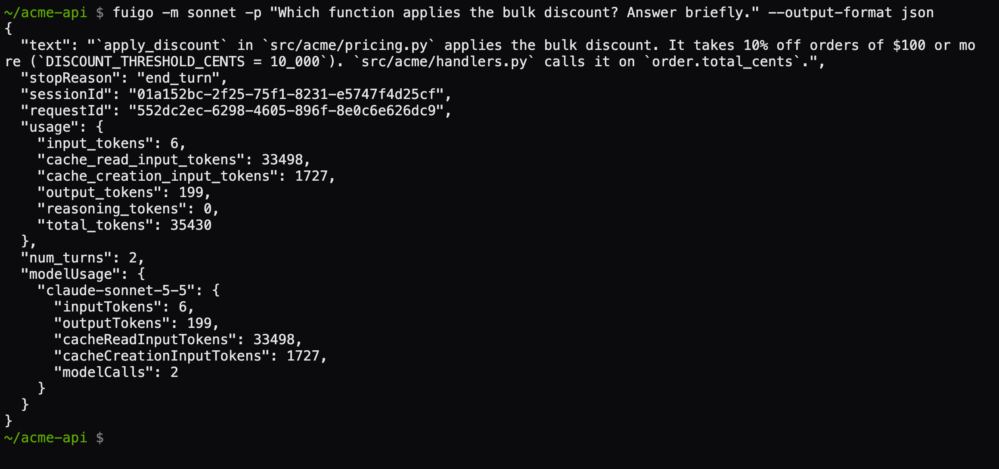
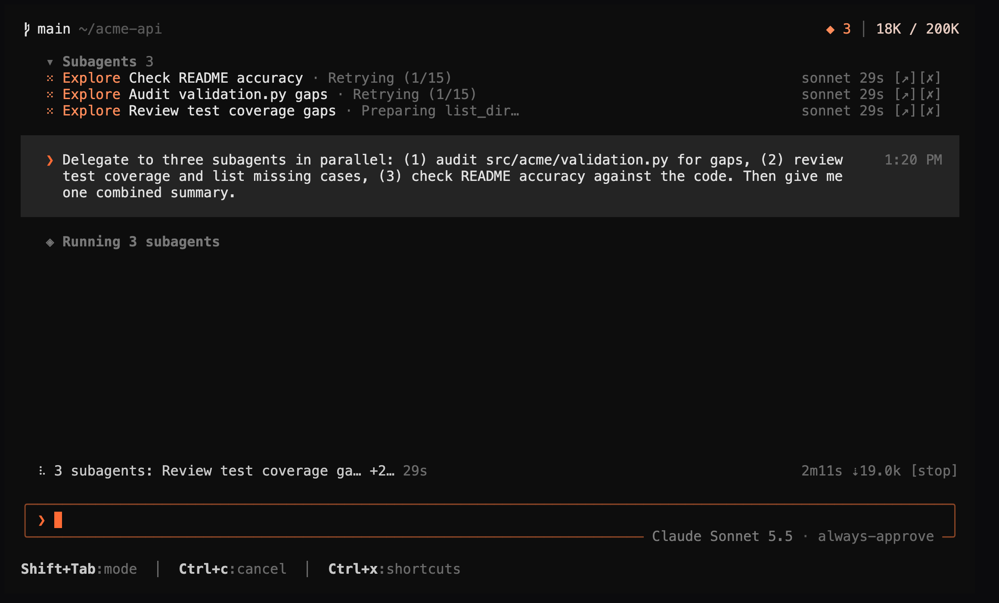
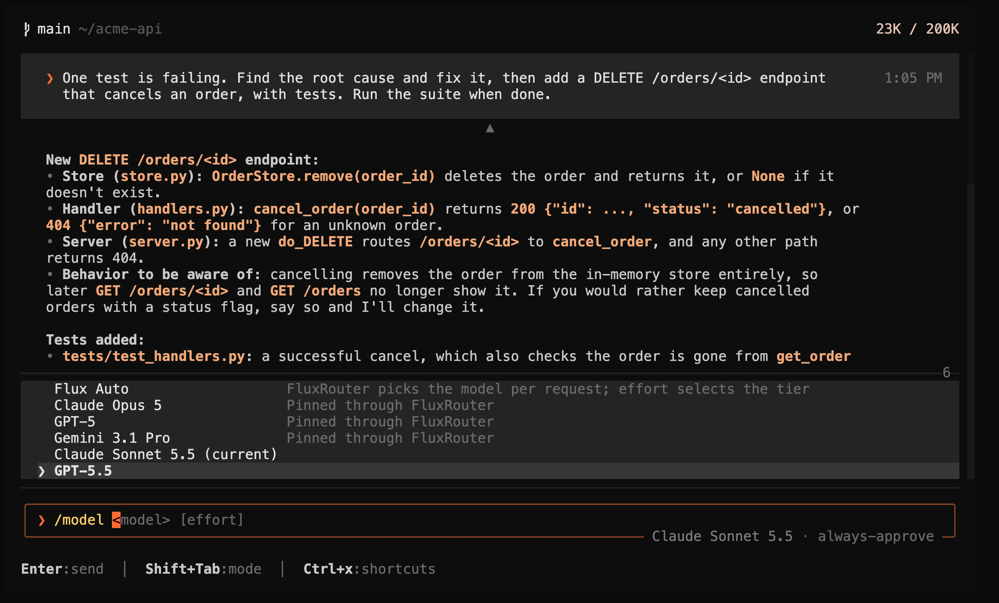
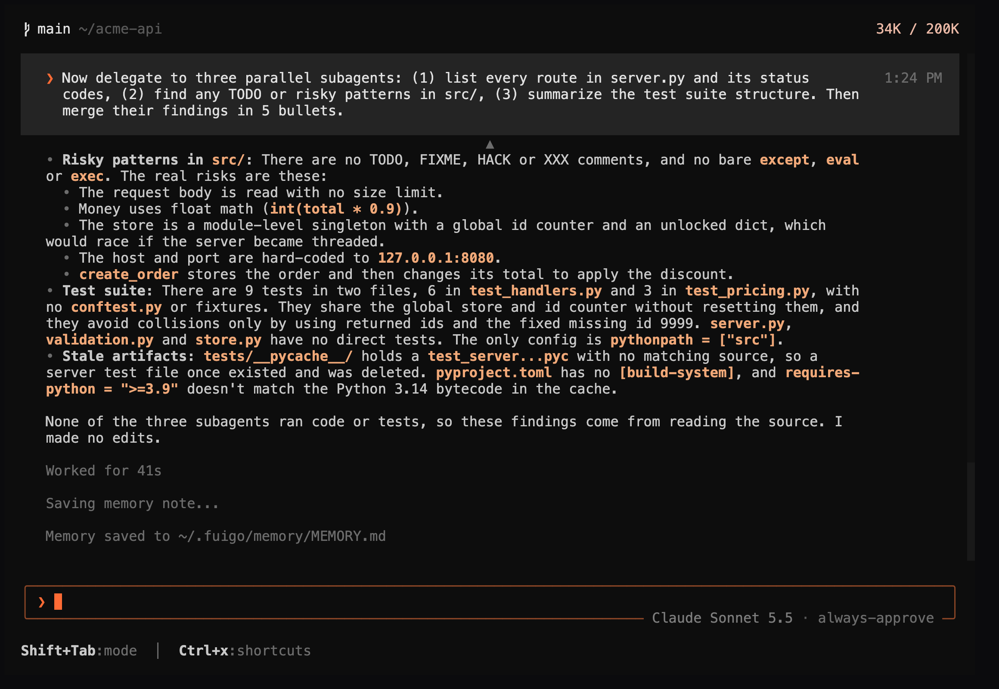

<div align="center">

<picture>
  <source media="(prefers-color-scheme: dark)" srcset="docs/assets/brand/banner-dark.png">
  <source media="(prefers-color-scheme: light)" srcset="docs/assets/brand/banner-light.png">
  
</picture>

# The open coding agent that holds its own with the best, on any model.

[](https://www.npmjs.com/package/fuigo)
[](https://www.npmjs.com/package/fuigo)
[](docs/connect-a-model.md)
[](https://github.com/FerroxLabs/fuigo/releases)
[](crates/codegen/fuigo-pager/docs/user-guide/15-agent-mode.md)
[](LICENSE)

</div>

On 24 hard, real-world engineering tasks, with every agent on the same model, Fuigo solved **43 of 48** runs. Claude Code solved 41 and Grok Build 41. Fuigo did it for **18–27% less per solved task**, with no timeouts. ([How we tested](docs/benchmark.md))

It isn't tied to one model company. Bring an OpenAI or Anthropic key, sign in with your ChatGPT subscription, or run a model on your own machine. It reads your code, edits it, runs your tests, and **asks before it changes a file or runs a command**. Kernel sandboxing (off until you turn it on), outbound destination checks and folder trust are built in, not bolted on. It remembers what it learned. And it is one engine: the same agent runs in your terminal, unattended in CI, or inside your product. It is the engine behind [Murage](https://github.com/FerroxLabs/murage)'s AI workforce.

Apache-2.0. Yours to own.

<div align="center">

[](#install)

[Install](#install) · [Why Fuigo](#why-fuigo) · [Three ways to work](#three-ways-to-work) · [Features](#features) · [Models](#model-routes) · [Memory](#memory) · [Benchmark](docs/benchmark.md) · [Docs](#documentation) · [Release notes](docs/release-notes-1.0.36.md)

</div>

## Install

Requires Node.js 20 or newer. The npm launcher installs the native binary for macOS, Linux or Windows (arm64 and x64); you can also take the binaries straight from [Releases](https://github.com/FerroxLabs/fuigo/releases).

```sh
npm install -g fuigo
```

Then, in a project:

```sh
fuigo login --provider chatgpt     # or set OPENAI_API_KEY / ANTHROPIC_API_KEY / FUIGO_API_KEY
fuigo                              # opens the terminal UI in the current folder
fuigo -p "Summarise this repo"     # same engine, one answer, no UI
```

On first launch Fuigo asks for a key, or offers one it finds in your environment. Every model route, including ChatGPT and Grok subscriptions, local servers and gateways, is in [Connect a model](docs/connect-a-model.md). Update later with `fuigo update` or `npm install -g fuigo@latest`.

<div align="center">



</div>

## Why Fuigo

- **Any model, one workflow.** OpenAI and Anthropic keys, ChatGPT and Grok subscriptions, Flux Router and other OpenAI-compatible gateways, and local servers such as Ollama. Switch models mid-session with `/model`.
- **One engine, three surfaces.** The same runtime behind the full-screen terminal UI, the headless `-p` command for scripts and CI, and an ACP server that editors and your own applications drive over JSON-RPC.
- **It asks before it acts.** Every command and edit goes through a permission step you control: approve one, approve a class for the session, or set allow and deny rules. Plan mode is read-only until you accept the plan. Kernel sandboxing on macOS and Linux is off by default; turn it on with `--sandbox <profile>`.
- **It remembers.** Local, workspace-scoped memory is on by default; sharing across workspaces and remote embeddings are explicit choices. Notes, decisions and session knowledge come back in later sessions, with their source attached.
- **Built to be extended.** Subagents and personas, MCP servers, skills, plugins, hooks and project rules. A single Rust binary with no runtime to install beyond Node for the launcher.

## Three ways to work

### Terminal UI

Open `fuigo` in a project. Fuigo reads files, runs commands and edits code, streaming each tool call into the scrollback. Attach files with `@path`, switch the permission mode with `Shift+Tab` (normal, plan, always-approve), and switch models with `/model <name>` or the model picker (`Ctrl+M` when the prompt is not focused).



```sh
fuigo                      # interactive session in the current folder
fuigo -c                   # continue the most recent session
fuigo --resume <ID>        # reopen a saved session
```

### Headless CLI

The same engine without the UI: one prompt in, text or JSON out. Pipe it, call it from CI, chain calls on the same session. Tool access is bounded by `--tools`, `--disallowed-tools`, `--allow` and `--deny`; `--yolo` (alias `--always-approve`) approves tool calls automatically for unattended runs.



```sh
fuigo -p "Review the staged changes for bugs" --output-format json | jq -r '.text'
fuigo -p "Now check for security issues" --resume "$(fuigo -p 'hello' --output-format json | jq -r .sessionId)"
fuigo -p "Run the tests and fix failures" --yolo --max-turns 8 --output-format streaming-json
```

Full flag reference, exit codes and the streaming event formats: [headless mode](crates/codegen/fuigo-pager/docs/user-guide/14-headless-mode.md).

### ACP agent

Run Fuigo as a long-lived agent for an editor, an SDK or an application of your own. The client speaks [ACP](https://agentclientprotocol.com) (JSON-RPC) over stdio, or over WebSocket with `serve`, and receives sessions, streamed replies, tool updates and permission requests. Zed is a supported client.

```sh
fuigo agent stdio                                          # local process, prompts for permission through the client
fuigo agent --always-approve --model <name> stdio          # unattended harness
fuigo agent serve --bind 127.0.0.1:2419 --secret <token>   # WebSocket server you run yourself
```

Protocol details, error shapes and a client skeleton: [agent mode](crates/codegen/fuigo-pager/docs/user-guide/15-agent-mode.md). The npm package also ships per-platform binaries (`@fuigo/darwin-arm64` and friends) for bundling Fuigo with an application; see the [launcher sources](crates/codegen/fuigo-pager/npm/fuigo).

## Features

| | |
| --- | --- |
| **Tools** | File read and edit, search, shell, web search and fetch, Git and checkpoints. Read-only tools and read-only shell commands run without prompting. |
| **Permissions** | Ask by default. Approve once, for the session, or always; allow and deny rules per tool and per command pattern; `.claude/settings.json` rules are honoured. [Guide](crates/codegen/fuigo-pager/docs/user-guide/22-permissions-and-safety.md) |
| **Plan mode** | The agent explores and writes a plan; nothing but the plan file is editable until you approve it. [Guide](crates/codegen/fuigo-pager/docs/user-guide/19-plan-mode.md) |
| **Sandbox** | Off by default. Choose a profile (`--sandbox workspace`, `read-only`, `strict`, or your own) to confine the agent and its commands with Landlock on Linux or Seatbelt on macOS. If an enforcing profile you asked for (anything but `devbox`) cannot be applied on Linux or macOS, Fuigo refuses to start rather than run unconfined; on Windows, where there is no sandbox, it starts and prints a warning at every start. [Guide](crates/codegen/fuigo-pager/docs/user-guide/18-sandbox.md) |
| **Subagents** | Parallel child sessions with their own context, agent types and personas, managed from `/agents`. [Guide](crates/codegen/fuigo-pager/docs/user-guide/16-subagents.md) |
| **MCP** | Stdio and remote servers, OAuth, elicitation; manage them from `/mcps`. [Guide](crates/codegen/fuigo-pager/docs/user-guide/07-mcp-servers.md) |
| **Skills, plugins, hooks** | Reusable instructions, a marketplace, and hooks that run around tool calls and sessions. [Skills](crates/codegen/fuigo-pager/docs/user-guide/08-skills.md) · [Plugins](crates/codegen/fuigo-pager/docs/user-guide/09-plugins.md) · [Hooks](crates/codegen/fuigo-pager/docs/user-guide/10-hooks.md) |
| **Sessions** | Saved automatically, resumable, forkable; a dashboard of every running session; named sessions that can message each other; an optional shared leader for multi-window use. [Sessions](crates/codegen/fuigo-pager/docs/user-guide/17-sessions.md) · [Dashboard](crates/codegen/fuigo-pager/docs/user-guide/23-dashboard.md) |
| **Background work** | Background tasks, scheduled prompts and follow-ups that survive compaction. [Guide](crates/codegen/fuigo-pager/docs/user-guide/20-background-tasks.md) |
| **Project rules** | Per-project instructions and agent definitions under `.fuigo/`. [Guide](crates/codegen/fuigo-pager/docs/user-guide/12-project-rules.md) |

<p align="center"></p>

## Model routes

| Route | How it connects | Setup |
| --- | --- | --- |
| **OpenAI** | Your API key, Chat Completions or Responses API | [`OPENAI_API_KEY` + a named model](docs/connect-a-model.md#openai-api-key) |
| **Anthropic** | Your API key, Messages API | [`ANTHROPIC_API_KEY` + a named model](docs/connect-a-model.md#anthropic-api-key) |
| **ChatGPT or Grok subscription** | `fuigo login --provider chatgpt` or `--provider xai`, then a model your plan grants | [Subscriptions](docs/connect-a-model.md#chatgpt-and-grok-subscriptions) |
| **Flux Router and compatible gateways** | A gateway endpoint plus its credentials | [Gateways](docs/connect-a-model.md#flux-router-and-other-gateways) |
| **Local models** | Any OpenAI-compatible server, such as Ollama | [Local servers](docs/connect-a-model.md#local-models) |

Models are named entries in `~/.fuigo/config.toml`; pick one with `fuigo -m <name>` or `/model <name>` in the UI. Protocol compatibility does not mean every model supports every agent feature.

<p align="center"></p>

## Memory

Fuigo keeps workspace memory on your machine and turns it on by default. Global sharing, remote embeddings and background model processing stay off until you choose them.

```toml
[memory]
enabled = true
global_enabled = false
```

Save a note with `/remember`, capture what a session learned with `/flush`, consolidate logs into topics with `/dream`, and browse everything with `/memory`. Captured statements carry their session, workspace and time, and are treated as historical claims rather than facts. Retrieval respects workspace boundaries, checks that sources are still fresh, and screens out recognised secret and instruction-injection patterns. Lexical search works with no embedding service; configure one explicitly for semantic retrieval.

<p align="center"></p>

Keyed corrections, retention, deletion and scoring: [memory guide](crates/codegen/fuigo-pager/docs/user-guide/13-memory.md).

## Documentation

The [user guide](crates/codegen/fuigo-pager/docs/user-guide/README.md) ships with the source and opens inside the UI with `/docs`.

| Topic | Guides |
| --- | --- |
| Start here | [Getting started](crates/codegen/fuigo-pager/docs/user-guide/01-getting-started.md) · [Authentication](crates/codegen/fuigo-pager/docs/user-guide/02-authentication.md) · [Keyboard shortcuts](crates/codegen/fuigo-pager/docs/user-guide/03-keyboard-shortcuts.md) · [Slash commands](crates/codegen/fuigo-pager/docs/user-guide/04-slash-commands.md) |
| Configure | [Configuration](crates/codegen/fuigo-pager/docs/user-guide/05-configuration.md) · [Config reference](crates/codegen/fuigo-pager/docs/user-guide/26-config-reference.md) · [Custom models](crates/codegen/fuigo-pager/docs/user-guide/11-custom-models.md) · [Theming](crates/codegen/fuigo-pager/docs/user-guide/06-theming.md) · [Status line](crates/codegen/fuigo-pager/docs/user-guide/25-status-line.md) |
| Automate | [Headless mode](crates/codegen/fuigo-pager/docs/user-guide/14-headless-mode.md) · [Agent mode (ACP)](crates/codegen/fuigo-pager/docs/user-guide/15-agent-mode.md) · [Background tasks](crates/codegen/fuigo-pager/docs/user-guide/20-background-tasks.md) · [Named sessions](crates/codegen/fuigo-pager/docs/user-guide/28-named-sessions.md) |
| Control | [Permissions and safety](crates/codegen/fuigo-pager/docs/user-guide/22-permissions-and-safety.md) · [Sandbox](crates/codegen/fuigo-pager/docs/user-guide/18-sandbox.md) · [Plan mode](crates/codegen/fuigo-pager/docs/user-guide/19-plan-mode.md) · [Monitoring usage](crates/codegen/fuigo-pager/docs/user-guide/24-monitoring-usage.md) |
| Extend | [MCP servers](crates/codegen/fuigo-pager/docs/user-guide/07-mcp-servers.md) · [Skills](crates/codegen/fuigo-pager/docs/user-guide/08-skills.md) · [Plugins](crates/codegen/fuigo-pager/docs/user-guide/09-plugins.md) · [Hooks](crates/codegen/fuigo-pager/docs/user-guide/10-hooks.md) · [Project rules](crates/codegen/fuigo-pager/docs/user-guide/12-project-rules.md) |

Release history: [CHANGELOG](CHANGELOG.md). Terminal compatibility notes: [terminal support](crates/codegen/fuigo-pager/docs/user-guide/21-terminal-support.md).

## Build from source

Rust via rustup ([`rust-toolchain.toml`](rust-toolchain.toml) pins the version), [DotSlash](https://dotslash-cli.com) for the hermetic tools in [`bin/`](bin/), a C/C++ toolchain and CMake.

```sh
git clone https://github.com/FerroxLabs/fuigo.git && cd fuigo
cargo install dotslash
cargo build --locked -p fuigo-pager-bin --release
```

The binary is `target/release/fuigo-pager` (`.exe` on Windows) and takes the same arguments as `fuigo`. The root [`Cargo.toml`](Cargo.toml) is generated; change dependencies in per-crate manifests. Crate layout: `fuigo-pager` (UI), `fuigo-shell` (runtime), `fuigo-sampler` (model requests), `fuigo-tools`, `fuigo-workspace`, `fuigo-mcp`, `fuigo-memory`, all under [`crates/codegen`](crates/codegen), with shared protocols in [`crates/common`](crates/common).

## Contributing and community

Ferrox Labs develops Fuigo internally and publishes the source for transparency and local builds; external pull requests are not accepted (see [CONTRIBUTING](CONTRIBUTING.md)). Bug reports and feature requests are welcome in [Issues](https://github.com/FerroxLabs/fuigo/issues) using the templates. Report security problems privately as described in [SECURITY](SECURITY.md). Please follow the [code of conduct](CODE_OF_CONDUCT.md).

## License and lineage

Fuigo is maintained by Ferrox Labs under the [Apache License 2.0](LICENSE). It originated as a modified derivative of [Grok Build](https://github.com/xai-org/grok-build), with substantial additional development and selectively integrated upstream changes. Fuigo is not affiliated with or endorsed by xAI or SpaceXAI.

See [NOTICE](NOTICE) for lineage and modification notices, [THIRD-PARTY-NOTICES](THIRD-PARTY-NOTICES) for dependency and source-port attribution, and [`third_party/NOTICE`](third_party/NOTICE) for vendored components. Third-party code retains its original licenses.

The name is the Japanese word for a forge bellows (鞴, *fuigo*). The wind mark is the [Lucide Wind](https://lucide.dev/icons/wind) icon, used under the ISC licence ([included](docs/assets/lucide-LICENSE.txt)).
